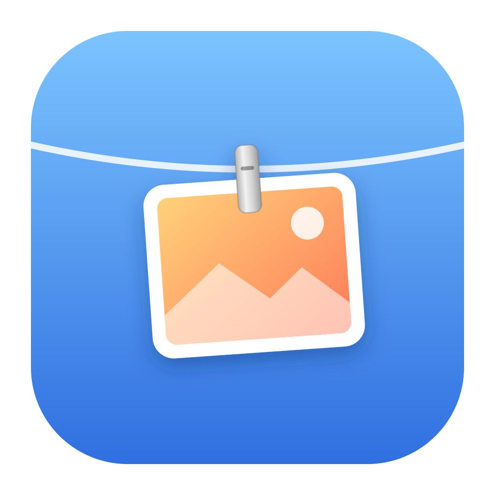
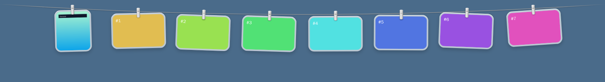

<p align="center"></p>

<h1 align="center">Pinza</h1>

<p align="center">
  Your screenshots, pegged to a line across the top of the screen.<br>
  One Rust + Tauri app for <b>Omarchy / Hyprland</b>, <b>macOS</b> and <b>Windows 11</b>.
</p>

<p align="center"></p>

Take a screenshot the way you always do. It hangs on a thin line along the
top of the screen for a moment, then the line tucks away. Rest the pointer at
the top edge and it slides back down. Move away and it's gone.

Pinza is a cross-platform port of [Tendedero](https://github.com/alejandrobujan/tendedero)
by Alejandro Buján, a macOS app written in Swift. The idea, the gestures and
the look are his. Tendedero's licence covers its code but not its name or
icon, so this port has its own.

## Gestures

| | |
|:--|:--|
| Click | Copy the image (a recording is copied as a file) |
| <kbd>Alt</kbd>-click | Copy the **text** in the screenshot |
| Double click | Open it |
| Press and hold | Mark it up: Satty on Omarchy, Preview on macOS, Paint on Windows |
| Drag into an app or folder | Hand over a copy. It stays on the line |
| <kbd>Ctrl</kbd>/<kbd>⌘</kbd>-click, or **Pick** | Pick several, then drag them together or join them |
| Click the cross | Take it down. The file stays where it is |
| Right click | Every action: Copy, Copy Text, Open, Mark Up, Redact, Keep, Send to Phone, Show in Folder, your own actions, Take Down, Trash |
| Rest the pointer at the top edge | Bring the line down |
| <kbd>Ctrl</kbd> <kbd>Alt</kbd> <kbd>T</kbd> | Show or hide the line, and take the keyboard (see Hyprland below) |

## Features

- **Keep.** A kept photo gets a coloured clip. It never falls off the line and
  is never cleaned up.
- **Clean up.** Tray → *Clean Up Screenshots* → after a day, a week or a
  month. Screenshots Pinza picked up go to the Trash after that time unless
  you kept them. The Trash, so nothing is lost by surprise. Off by default.
- **Copy text.** Reads the text in a screenshot on your machine: Tesseract on
  Linux, Apple's Vision on macOS, the built-in Windows OCR on Windows.
- **Redact.** Blurs email addresses, phone and card numbers, IP addresses,
  links with tokens, API keys and long secrets into a new copy, which hangs
  next to the original. It finds what it can read; check before you share.
- **Hide in full screen and while sharing.** No line over a video, game or
  presentation. On Hyprland it also hides while the screen is shared. On
  macOS and Windows it is left out of screen sharing, recordings and
  screenshots.
- **Keyboard.** Open the line with the shortcut and it takes the keyboard
  until it tucks away (8 s without a key or the pointer):

  | Key | |
  |:--|:--|
  | <kbd>←</kbd> <kbd>→</kbd> or <kbd>H</kbd> <kbd>L</kbd> | Move |
  | <kbd>Enter</kbd>, <kbd>1</kbd>–<kbd>9</kbd> | Copy |
  | <kbd>T</kbd> <kbd>O</kbd> <kbd>E</kbd> <kbd>R</kbd> <kbd>K</kbd> <kbd>S</kbd> <kbd>F</kbd> | Copy text, Open, Mark up, Redact, Keep, Send to phone, Show in folder |
  | <kbd>Space</kbd>, <kbd>J</kbd> / <kbd>Shift</kbd> <kbd>J</kbd> | Pick, join top to bottom / side by side |
  | <kbd>X</kbd>, <kbd>Shift</kbd> <kbd>Delete</kbd> | Take down, Trash |
  | <kbd>Tab</kbd>, <kbd>/</kbd>, <kbd>?</kbd>, <kbd>Esc</kbd> | Next line, Search, Keys, Close |

- **Screen recordings.** Recordings hang too and play while the pointer is
  on them. Animated GIFs move. A recording only hangs once it has finished
  writing.
- **Join.** Pick two or more and join them top to bottom or side by side
  into `Pinza stack.png`.
- **Search.** Every screenshot's text is read in the background (Tesseract
  needed on Linux). Tray → *Search Screenshots…*, <kbd>/</kbd> on the line, or
  `pinza search`. Search by text, file name or date (`2026-10-09`). Enter
  copies a result and hangs it back on the line.
- **Omarchy themes.** The glass, text and accent follow the current Omarchy
  theme, live, light or dark. Elsewhere the system's light or dark mode.
- **Send to phone.** Shows a QR code for a link on your local network. The
  link works for 10 minutes, and only on the same Wi-Fi. Nothing goes
  through the internet. Windows may ask once to allow Pinza on private
  networks.
- **Several lines.** For example, one for work, each watching its own folders.
  A screenshot hangs on its line and brings it into view. Switch with
  <kbd>Tab</kbd>, the name under the line, or the tray.
- **Your own actions.** Commands in the settings appear on every photo. If
  one prints a link (an upload, say), the link is copied.

## Where screenshots come from

Pinza never takes screenshots. It watches the folder your system saves them to.

| System | Shortcut you already use | Folder watched |
|:--|:--|:--|
| Omarchy (Hyprland) | <kbd>Print</kbd> (hyprshot), screen recorder | `$OMARCHY_SCREENSHOT_DIR`, else `~/Pictures` and `~/Pictures/Screenshots`; recordings in `$OMARCHY_SCREENRECORD_DIR` or `~/Videos` |
| Other Linux | Your screenshot tool | `~/Pictures/Screenshots`, `~/Pictures` |
| macOS | <kbd>⌘</kbd><kbd>⇧</kbd><kbd>3</kbd> / <kbd>4</kbd> / <kbd>5</kbd> | The folder set in <kbd>⌘</kbd><kbd>⇧</kbd><kbd>5</kbd> → Options (usually the Desktop, where only real screenshots count) |
| Windows 11 | <kbd>Win</kbd><kbd>Shift</kbd><kbd>S</kbd>, <kbd>Win</kbd><kbd>PrtScn</kbd> | `Pictures\Screenshots` (also under OneDrive); recordings in `Videos\Screen Recordings` |

Only files that appear after Pinza starts are hung, so an existing Pictures
folder is left alone. To watch other folders, list them in the settings. A
full line holds 8 photos; the oldest that is not kept falls off the far end.
Delete or move a file and its photo falls off by itself.

## Install

Pre-built installers come from the **Pinza** GitHub Actions workflow: open the
latest run and download `pinza-Linux`, `pinza-macOS` or `pinza-Windows`.
Pushing a tag like `v0.1.0` also attaches them to a draft release.
The builds are not signed yet. See the notes for each system below.

### Omarchy / Hyprland

```sh
git clone https://github.com/jaabiri/pinza && cd pinza
scripts/install-linux.sh
```

The script installs the libraries with pacman (`webkit2gtk-4.1`, `gtk-layer-shell`,
`libayatana-appindicator`, plus `tesseract` for reading text and `ffmpeg` for
recording previews), builds a release binary into `~/.local/bin/pinza` and
adds a desktop entry. Then add to `~/.config/hypr/hyprland.conf`:

```ini
exec-once = pinza
bind = CTRL ALT, T, exec, pinza toggle
bind = CTRL ALT, F, exec, pinza search
```

On Wayland, apps can't grab global shortcuts, so Hyprland handles the key and
runs `pinza toggle`, which passes it to the running Pinza. `pinza show`,
`pinza hide`, `pinza clear`, `pinza search`, `pinza next-line` and
`pinza quit` work too. See
[`docs/hyprland.conf`](docs/hyprland.conf) for optional blur rules.

On Wayland, Pinza is a *layer-shell* surface: it sits under Waybar, never
takes keyboard focus, and takes the pointer only over the photos. No window
rules are needed. The tray icon shows up in Waybar's tray.

### macOS

Open the `.dmg` and drag Pinza to Applications. Until the app is signed,
right-click → Open the first time, or run
`xattr -dr com.apple.quarantine /Applications/Pinza.app`.
Pinza lives in the menu bar, with no Dock icon. Rest the pointer in the menu
bar to bring the line down.

### Windows 11

Run the `-setup.exe` or `.msi`. SmartScreen warns about unsigned apps:
choose *More info → Run anyway*. WebView2 is already part of Windows 11.
Snipping Tool saves screenshots automatically by default. If yours doesn't,
turn on *Automatically save screenshots* in Snipping Tool settings.

## Settings

The tray menu has *Search Screenshots…*, *Clear the Line*, *Clean Up
Screenshots*, *Sounds*, *Show at Top Edge*, *Hide in Full Screen and
Sharing*, *Open at Login* and *Edit Settings…*, which opens `config.json`:

```json
{
  "folders": [],
  "lines": [{ "name": "Work", "folders": ["~/Work/Screenshots"] }],
  "max_items": 8,
  "shortcut": "Ctrl+Alt+T",
  "sound": true,
  "reveal_at_edge": true,
  "clean_up_after_hours": 0,
  "hide_in_full_screen": true,
  "theme": "auto",
  "ocr_language": "eng",
  "actions": [
    { "name": "Upload", "command": ["sh", "-c", "curl -sF \"file=@$1\" https://0x0.st", "_", "{path}"] },
    { "name": "Optimise", "command": ["oxipng", "-o", "4", "{path}"] }
  ]
}
```

- `theme`: `auto` (Omarchy theme if there is one, else the system),
  `omarchy`, `light` or `dark`.
- `ocr_language`: Tesseract languages on Linux, e.g. `eng+spa`. Install them
  with `sudo pacman -S tesseract-data-spa`.
- `actions`: each `command` runs directly, without a shell, with `{path}`,
  `{name}` and `{dir}` filled in. If you need a shell, pass the file as
  `"$1"` as above. Never paste `{path}` into the script text: a file name
  with a quote or bracket would break it.

It lives in `~/.config/app.pinza.Pinza/` (Linux),
`~/Library/Application Support/app.pinza.Pinza/` (macOS) or
`%APPDATA%\app.pinza.Pinza\` (Windows), next to `line.json` (what is
hanging) and `history.json` (what was hung, with its text, for search).
Restart Pinza after editing folders, lines, actions or the shortcut.

On Hyprland the search window opens as a normal window. To float it:
`windowrule = float, title:^(Search Screenshots)$` (adjust to your
Hyprland's rule syntax).

## Build from source

You need Rust (stable) and Node 18+ (only for the Tauri CLI; the web side has
no build step). Linux also needs the libraries listed in
`scripts/install-linux.sh`.

```sh
npm install
npm run dev        # run it
npm run build      # installers in src-tauri/target/release/bundle/
```

Plain `cargo run --manifest-path src-tauri/Cargo.toml` works too.
`RUST_LOG=pinza=debug` shows what it is watching and hanging.

## How it works

Learning Rust? [`docs/LEARNING.md`](docs/LEARNING.md) walks through the
techniques, the system APIs and the crates used here, with links into the
code and to deeper reading.

| File | Role |
|:--|:--|
| `src-tauri/src/main.rs` | Startup, the window, the command line |
| `src-tauri/src/controller.rs` | Bringing the line down and tucking it away |
| `src-tauri/src/watcher.rs` | Notices new screenshots |
| `src-tauri/src/folders.rs` | Where each system saves screenshots |
| `src-tauri/src/line.rs` | What is hanging, thumbnails, persistence |
| `src-tauri/src/actions.rs` | Clipboard, open, mark up, trash, your own actions |
| `src-tauri/src/commands.rs` | What the web views can ask for; menus; drag-out |
| `src-tauri/src/ocr.rs` | Reading text: Tesseract, Vision, Windows OCR |
| `src-tauri/src/images.rs` | Redacting and joining |
| `src-tauri/src/history.rs` | Search index and clean-up |
| `src-tauri/src/share.rs` | Send to phone: local link and QR code |
| `src-tauri/src/fullscreen.rs` | Staying away in full screen and screen sharing |
| `src-tauri/src/theme.rs` | Omarchy theme colours |
| `src-tauri/src/linux.rs` | Layer shell, input regions and keyboard on Wayland |
| `src-tauri/src/tray.rs` | The tray / menu bar icon |
| `src/main.js` | The rope, the clips, the swing, gestures and keys |
| `src/styles.css` | Glass frames and aluminium clips |
| `src/search.*` | The search window |

The window is a transparent strip, always on top, that never takes focus.
To let clicks through everywhere except the photos:

- **macOS and Windows:** Rust polls the cursor 25 times a second. It turns
  click-through off only while the pointer is over a photo, and brings the line
  down when the pointer rests at the top of a screen.
- **Linux:** Wayland never tells an app where the pointer is, so the window's
  input region shrinks to the photos, and GTK reports the pointer coming and
  going. While the line is tucked away, a 4 px strip along the top catches
  the pointer.

## Privacy

Everything runs on your machine. Text is read on the device. The only
network code is *Send to phone*, which serves one file on your local network
for 10 minutes, behind a random link, when you ask for it.

## Status

- Tested on Linux, Wayland (wlroots, with layer shell) and X11: everything
  above, including copying text, redacting, keeping, clean-up, send to phone
  (QR decoded and the file fetched), your own actions, joining, the keyboard,
  search, recordings, two lines and live Omarchy theme changes. Full screen
  detection on Hyprland is covered by tests of its event parsing but has not
  run on Hyprland itself.
- Windows: compiles, including the OCR and full-screen code, but has not run
  on a real machine yet. macOS: built by CI only. Reading text on macOS
  goes through Vision with an AppleScript bridge, untested.
- On Wayland, <kbd>Ctrl</kbd>- and <kbd>Alt</kbd>-click can't be told apart from a
  plain click, because the line never takes keyboard focus from your apps.
  Use the right-click bar (**Copy Text**, **Pick**) or the keyboard instead.
- Not yet ported from Tendedero: the flight from the capture spot to the
  line, the macOS setting that sends screenshots straight to Pinza, and
  translations.
